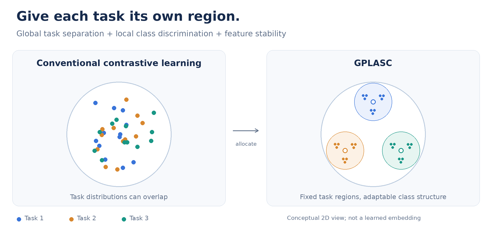
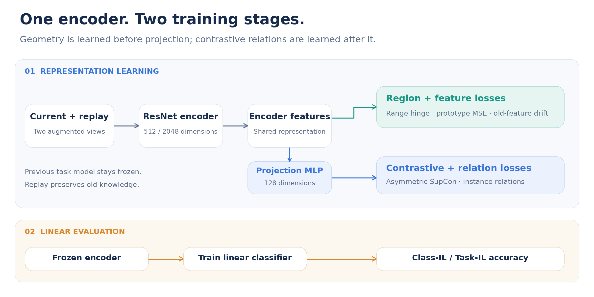

<div align="center">

# GPLASC

### Global Pre-fixing, Local Adjusting
**A Simple yet Effective Contrastive Strategy for Continual Learning**

Jia Tang · Xinrui Wang · Songcan Chen<br>
Nanjing University of Aeronautics and Astronautics

[**Paper**](https://arxiv.org/abs/2509.15347) · [**Quick start**](#quick-start) · [**中文说明**](docs/README.zh-CN.md) · [**Implementation**](docs/implementation.md) · [**Citation**](#citation)

</div>



**Learn new classes while keeping old representations organized.** GPLASC allocates distinct feature regions to different tasks, learns class structure within each region, and limits old-feature drift through replay-based distillation.

## How it works

Continual learning requires both **within-task discrimination** and **between-task separation**. A model must distinguish classes that may never have appeared together during training.

| Component | Idea | Purpose |
|---|---|---|
| **Global pre-fixing** | Place task prototypes at the vertices of a fixed simplex ETF. | Separate different tasks in representation space. |
| **Local adjusting** | Combine contrastive learning with region-range and prototype-position constraints. | Learn discriminative class structure inside each task's region. |
| **Feature distillation** | Keep replayed examples close to their previous encoder features. | Reduce drift as new tasks arrive. |

*The overview is a conceptual illustration, not a measured embedding. Colors denote tasks; the small groups represent classes, and hollow circles denote task prototypes.*

### From representations to predictions



The maintained **Co²L + GPLASC v2** path uses two stages:

1. **Representation learning:** train the encoder and projection head on the current task plus replay examples. Geometric constraints and feature distillation use normalized encoder features; asymmetric SupCon and relation distillation use normalized projections.
2. **Linear evaluation:** freeze the encoder, discard the projection head, and train a class-balanced linear classifier. Report both Class-IL and Task-IL accuracy.

The released v2 loss behavior and its differences from the paper are documented in [implementation notes](docs/implementation.md). Earlier experiments remain in [`legacy/`](legacy/).

## Quick start

### 1. Install

Use **Python 3.10+** and install a compatible PyTorch/torchvision pair for your machine, then:

```bash
git clone https://github.com/tAnGjIa520/GPLASC.git
cd GPLASC
python -m pip install -e .
```

Tested with Python 3.10, PyTorch 2.9.0+cu128, torchvision 0.24.0+cu128, and an NVIDIA H200. No pretrained weights, Apex, TensorBoard, or Docker are required.

### 2. Prepare CIFAR-10

On a machine with network access:

```bash
python -m gplasc download --dataset cifar10 --data-root /path/to/data
```

Training and evaluation read local files only. For an offline GPU server, prepare the data on a networked machine and share or copy the data directory. See [data preparation](docs/running.md#prepare-data) for the download mirror and processed Tiny-ImageNet format.

### 3. Run a smoke check

```bash
CUDA_VISIBLE_DEVICES=0 python -m gplasc smoke \
  --data-root /path/to/data --output runs/smoke --device cuda
```

This runs two small real-data tasks, replay and distillation, checkpoint reload, and linear evaluation. A successful run writes `runs/smoke/smoke_result.json` with `"status": "passed"`. Use a fresh output directory for each run. CPU execution is available with `--device cpu`.

## Experiments

Train representations, then evaluate the final task checkpoint:

```bash
CUDA_VISIBLE_DEVICES=0 python -m gplasc train \
  --config configs/cifar10.json --data-root /path/to/data \
  --output runs/cifar10 --device cuda

CUDA_VISIBLE_DEVICES=0 python -m gplasc evaluate \
  --checkpoint runs/cifar10/task_04.pt --data-root /path/to/data \
  --output runs/cifar10-evaluation --device cuda
```

| Dataset | Task split | First / later task epochs | Configuration |
|---|---:|---:|---|
| CIFAR-10 | 5 × 2 classes | 500 / 100 | [cifar10.json](configs/cifar10.json) |
| CIFAR-100 | 5 × 20 classes | 500 / 100 | [cifar100.json](configs/cifar100.json) |
| Tiny-ImageNet | 10 × 20 classes | 500 / 50 | [tiny-imagenet.json](configs/tiny-imagenet.json) |

All three configurations use 100 epochs for linear evaluation. `memory_size` is the total replay budget; `train_tasks` limits the trained prefix without changing the full-sequence ETF. A single visible GPU is recommended.

**These are starting configurations, not newly verified benchmark results.** The refactored implementation has passed numerical regression tests and small GPU runs; full paper-level accuracy has not been revalidated.

## Verification

| Check | Verified scope |
|---|---|
| **11 CPU regression tests** | Legacy loss agreement, ETF geometry, empty replay, memory updates, and task-boundary resume equivalence. |
| **Real CIFAR-10 GPU smoke** | Two tasks with ResNet-18, a 32-example buffer, checkpoint reload, and linear evaluation. |
| **GPU resume through task 5** | Restore a task-1 checkpoint, train tasks 2–4, and evaluate all 10 classes. |

See the [verification record](docs/verification.md) for settings and measured outputs. The smoke runs validate execution, not convergence.

```bash
python -m pip install -e '.[dev]'
pytest -q
ruff check gplasc tests
ruff format --check gplasc tests
```

## Documentation and code

| Resource | Contents |
|---|---|
| [Running guide](docs/running.md) | Installation, data formats, training, task-boundary resume, and outputs. |
| [Implementation notes](docs/implementation.md) | Objective, intentional changes, and migration from legacy scripts. |
| [中文说明](docs/README.zh-CN.md) | Chinese quick start and implementation overview. |
| [`gplasc/`](gplasc/) | Configuration, data, models, losses, training, evaluation, and checkpoint I/O. |
| [`configs/`](configs/) · [`tests/`](tests/) | Experiment settings and regression tests. |
| [`legacy/`](legacy/) | Archived research variants and original scripts. |

The diagrams are stored locally as PNG and editable SVG in [`docs/assets/`](docs/assets/). They can be regenerated with `python docs/assets/generate_figures.py` on a system with Pillow and DejaVu Sans fonts.

## Citation

```bibtex
@article{tang2025gplasc,
  title={Global Pre-fixing, Local Adjusting: A Simple yet Effective Contrastive Strategy for Continual Learning},
  author={Tang, Jia and Wang, Xinrui and Chen, Songcan},
  journal={arXiv preprint arXiv:2509.15347},
  year={2025}
}
```

## Acknowledgments

This implementation builds on [Co²L](https://github.com/chaht01/Co2L) and [SupContrast](https://github.com/HobbitLong/SupContrast). ResNet code derives from [pytorch-classification](https://github.com/bearpaw/pytorch-classification), and the processed Tiny-ImageNet convention follows [Mammoth](https://github.com/aimagelab/mammoth). Source attribution is retained in the model module and archived code.
